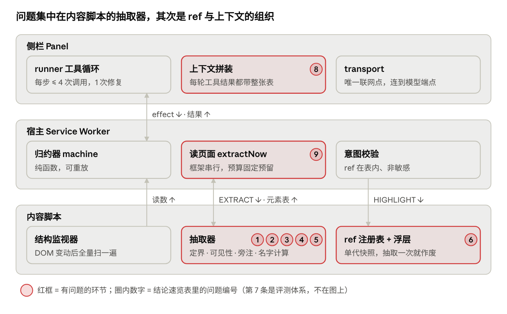
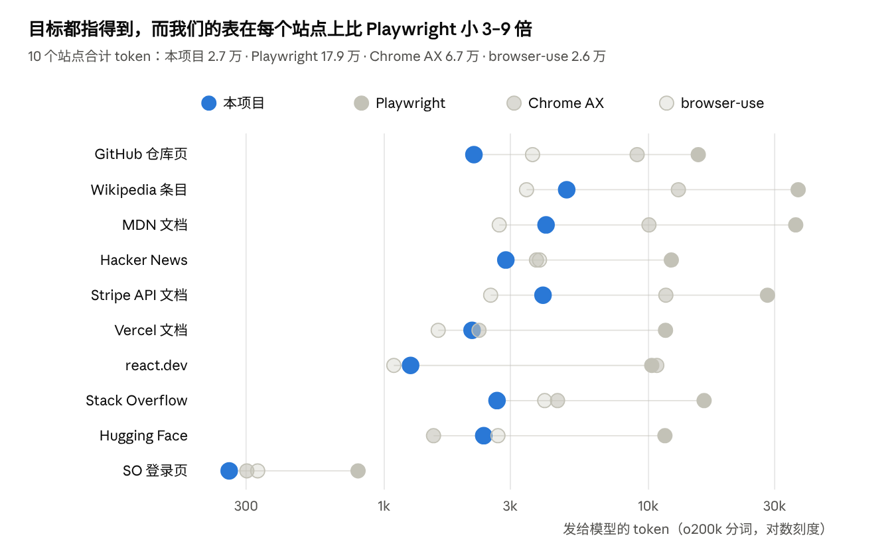

# agent-extension 架构审核与 HTML 抽取器优化报告

Nov 5, 2026 · @lkzchain

## 结论速览

整体工程底子很扎实（纯归约器、唯一联网点、56 条架构守卫、发给模型的字节冻结），**问题主要集中在 HTML 抽取器**：实测确认 5 个会让模型「看错页面」的缺陷，以及一个在大页面上让名字计算占用约 1 秒主线程的性能热点。Agent 层最大的结构性问题是 **ref 每次抽取即作废**，以及**页面上的状态文字（报错、提示、加载中）根本不进上下文**。

依据：通读 `src/` 全部源码与 `.scratch/` 规格记录，并把抽取器打包后用 Playwright 在 Chromium 里对 7 个最小复现页面实测（仓库代码未做任何改动）。

| # | 问题 | 类别 | 实测证据 | 优先级 |
| --- | --- | --- | --- | --- |
| 1 | 一个非模态 `popover`（如 toast「已保存」）被当成模态框，整页只扫描它自己 | 抽取器缺陷 | 复现页：元素表 **0 条** | P0 |
| 2 | `nearby` 旁注把 `<script>` / `<style>` / 隐藏文字送进提示词 | 抽取器缺陷 · 安全 | 复现页：按钮旁注是一段 JS 源码 | P0 |
| 3 | 报错、提示、状态文字（`role=alert/status`、`aria-describedby`、`aria-invalid`）模型一律看不到 | 表征缺口 | 复现页：「名称已被占用」不在表里 | P1 |
| 4 | 叠放模态取了被压在下面的那层；`fieldset[disabled]` 里的控件不标禁用；`aria-hidden` 宿主下的 shadow 内容照样进表 | 抽取器缺陷 | 三个复现页均确认 | P1 |
| 5 | 页面变动后名字计算（`computeAccessibleName`）约 950 ms，逼近 1500 ms 看门狗 | 性能 | 1500 行表格页：脏样式 1129 ms，暖缓存 147 ms | P1 |
| 6 | ref 只在一个快照代内有效，任何一次抽取都让前一张表作废 | Agent 架构 | 每轮 observe 重发全表；`snapshot_stale` 一类失败 | P1 |
| 7 | 抽取器改动无法离线评测：决策语料存的是「表」不是「页面」 | 评测体系 | 规格自述：新字段在回放里为 0 | P1 |
| 8 | 步内上下文线性增长：每轮工具结果都带一整张表，旧表不清理 | Agent 架构 | 4 次调用 × 约 10.7k token | P2 |
| 9 | 嵌入框架串行读取、预算按固定额度预留、提示词仍说「框架里看不到」 | Agent 架构 | `background.ts:398`、`system.ts` MARK\_GUIDE | P2 |

## 架构总览

三个进程各管一段：侧栏发模型请求，宿主用纯归约器做全部判断，内容脚本在页面里抽取元素表并画框。



红框里的四个环节承担了 9 个问题中的 8 个，其中 5 个在抽取器——这也是「抽取器优化方案」放在最前面的原因。

## Agent 工具架构问题

决策与执行分离、意图模块化、双预算这三件事做对了；要改的是**模型看到的世界怎么组织**：元素的身份、步内上下文、以及页面状态文字的通道。

做对了的（保持不动）：

- **纯归约器 + 侧栏执行**：Service Worker 30 秒回收后靠 `storage.session` 重放，模型调用放在活得久的侧栏。
- **一个意图一个模块**（`agents/guide/registry.ts`）：schema、policy、校验、后果在同一处，加工具只改一个文件。
- **输出即工具**：`tool_choice: required` + `parallel_tool_calls: false` + 一次修复 + 宿主复核 ref（在表内、非敏感）。
- **双预算**：每步最多 4 次调用、最后一次只给输出类工具；每趟最多 12 步。
- **不可信内容隔离**：nonce 包裹页面文字，进提示词的字符串统一过 `redact`。

需要改的：

| 问题 | 现状（代码位置） | 后果 | 建议 |
| --- | --- | --- | --- |
| ref 单代作废 | `registry.ts` 只有一个全局 generation，`extract()` 每次都 commit 新代 | 读数或侧栏抽取插在「模型回答」与「上屏」之间时，`explain` 直接 `snapshot_stale`，`point` 退回 descriptor 重绑（再做一次全量抽取）；工具结果只能重发全表 | 稳定 ref：`WeakMap<Element, number>`，同一元素跨抽取保持同一编号，新元素取新号；校验改为「仍在文档中 + role/name 未变」 |
| 状态文字没有通道 | `extract.ts` 只保留可交互元素与地标/标题；`invalid`/`required` 关在 `+context` 后面，而产品只用 `interactive` | 提交失败后模型看不到报错，只会再指一次同一个按钮；`wait_for` 要模型说出「具体文字」，它却从没见过页面文字 | 加一个有上限的 `notices` 段和控件描述（见「抽取器优化方案」第 4 条） |
| 步内上下文线性增长 | `agent.ts` 的 `buildMessages` 原样回放每一轮；`buildToolResultText` 每轮输出全表 | 400 节点约 10.7k token，一步最后一次调用最多带 4 张表，其中 3 张的 ref 已作废 | 旧轮次的表替换成一行「已被下一张表取代」；有稳定 ref 后只发增量（新增 / 消失 / 状态变化） |
| 宿主编排堆在一个文件 | `background.ts` 1403 行：RPC 路由、读页面、框架合并、读数、跨站确认、主题 | `extractNow` / `splitBudget` 只能靠 e2e 覆盖 | 抽出 `host/page-reader.ts`（注入、枚举框架、并行读取、合并、预算），用端口注入做单测 |
| 框架串行、预算固定预留 | `extractNow` 对每个框架逐个 `await`；`splitBudget` 给每个框架预留 20–60 个名额，用不完不回流 | 5 个框架就是 5 次串行往返；顶层被白白砍掉名额 | `Promise.all` 并行；各文档先交全集条数，再按实际需要分配 |
| 提示词与能力漂移 | `system.ts` 的 MARK\_GUIDE 与 `extract.ts` / `project.ts` 注释仍写「内容脚本只在顶层文档」，实际已经读进框架 | 模型同时收到「框架里看不到」和「已经读进来了」两句互相矛盾的话 | 统一措辞；model-input 快照审查时加一条「说法与能力一致」 |
| 评测断层 | 决策语料存的是当年产出的 `PromptTable`；抽取器评测 22 个夹具里只有 1 张真实页面 | 新字段（`landmark`、`nearby`）在回放里永远是 0，抽取器改进无法证明对决策有用 | 录制时同时存 DOM 快照（含 shadow），回放时用当前抽取器重新抽取；补云控制台类真实页面 |

## HTML 抽取器现状

抽取器的「只删重复、入口优先、如实报裁剪」策略是对的，但**定界、可见性、旁注三处有确定性缺陷**，名字计算在页面变动后是主要耗时。

当前管线（`src/core/extractor/`）：

1. **定界** `findModalScope`：有可见的模态框就只扫它。
2. **遍历** `walk`：`querySelectorAll('*')` 逐个 `matches(CANDIDATE_SELECTOR)`，进开放 shadow root，记下 iframe。
3. **可见性** `isVisible`：`closest(aria-hidden/inert/hidden)` + 尺寸 ≥ 2px + `checkVisibility`。
4. **语义**：`getRole` → 只留可交互 / 地标 / 标题 → `computeAccessibleName`（再兜底 title、svg title、testid、href）→ state → sensitive → href → `rowLabel` → `nearby`。
5. **身份** `describeAll`：path（地标名 / 前置标题 / 行标签）+ `nth`。
6. **裁剪** `dropRestatements` → `prune`：入口优先、文档顺序，上限 120 / 400 / 800 个节点。
7. **序列化** `toPromptText`：缩进树，带 `~`、`!secret`、`+new`、`→/末两段`、`· 旁注`。

实测确认的缺陷（每条都用一个最小页面在 Chromium 里跑过当前代码）：

| 缺陷 | 位置 | 复现页面 | 实测结果 | 对引导的影响 |
| --- | --- | --- | --- | --- |
| 非模态 popover 被当成模态 | `visibility.ts` `findModalScope` 第二段 `[popover]:popover-open` | 导航 + 主体 + 一个 `showPopover()` 的 toast | **0 条元素**，`modalScoped: true` | toast、tooltip、用 popover 做的菜单一出现，模型就看到空页面 |
| 旁注吞进脚本源码 | `extract.ts` `proseOf` 用 `textContent`，不排除 `script/style/template/noscript`，也不看可见性 | 一个容器里只有一个按钮和一段 `<script>` | 按钮旁注是 `document.getElementById(...)` 这样的 JS | 噪音；内联配置（`__INITIAL_STATE__` 一类）可能被送到端点，`redact` 只认 8 种前缀 |
| 叠放模态取错层 | `findModalScope` 取文档顺序第一个 | 两个先后 `showModal()` 的 dialog | 取到被浏览器设为 inert 的下层 | 「确认删除」二次确认框场景下指向点不动的控件 |
| `fieldset[disabled]` 不标禁用 | `semantics.ts` `resolveState` 用 `input.disabled`（只反映自身属性） | `<fieldset disabled>` 里的按钮与输入框 | 没有 `[disabled]` | 指向一个点不动的按钮 |
| 隐藏判定不跨 shadow | `isVisible` 的 `el.closest()` 在 shadow 边界停住 | `aria-hidden` 宿主下开放 shadow 里的按钮 | 照样进表 | 被页面作者藏起来的组件被当成可点 |
| 封闭 shadow root 完全不可见 | `walk` 只读 `el.shadowRoot` | `mode: 'closed'` 里的按钮 | 不在表中 | 用封闭 shadow 的组件库整片丢失 |
| 状态文字缺失 | 语义过滤 + `invalid` 关在 `+context` | `role=alert` 报错、`role=status`、`aria-describedby` 提示 | 三者都不在表中 | 模型不知道上一步为什么失败 |

耗时（同一页面连续抽取三次；「样式变动后」= 插入一条无关 CSS 规则再抽取，模拟页面刚变完时的真实状态）：

| 页面 | 节点数 | 首次 (ms) | 缓存热 (ms) | 样式变动后 (ms) | 其中名字计算 (ms) |
| --- | --- | --- | --- | --- | --- |
| 1500 行实例表（每行 1 链接 + 3 按钮） | 6004 | 1097 | 147 | 1129 | 955（热时 46） |
| `repo-home`（GitHub 存档夹具） | 326 | 17 | 10 | 9 | 2–8 |

结论：普通页面很快，但大表格页在「页面刚变完」时会卡住主线程约 1.1 秒，而引导恰恰在这个时刻抽取。大头是 `computeAccessibleName` 对每个子节点取计算样式（含 `::before`/`::after`），任何样式失效都让这份缓存作废。同一批 6002 个链接和按钮走「纯文本快路径」只要 1.7 ms。

另有三处按代码阅读判断的重复计算（未单独计时）：`nearbyTextOf` 对每层祖先跑一次 `querySelectorAll`；`rowLabelOf` 对同一行的每个控件都重算一遍；`extractStructureHash` 先对全部候选跑 `isVisible` 再看 role，而它在每次 DOM 变动后都会跑。

## 抽取器优化方案

按「先修会让模型看错的、再补看不到的、最后做快」排序，共 9 项；前 3 项是纯修复，不增加 token，可以直接做。

| # | 改动 | 怎么改 | 收益 | 成本 | 验收 |
| --- | --- | --- | --- | --- | --- |
| 1 | 修定界 | `findModalScope` 只认浏览器强制的模态（`dialog:modal`、可见的 `aria-modal=true`）；popover 不再定界；多个模态取**最后一个**可见的；在 `walk` 遇到的 shadow root 里也找 | 消除「整页变空」和「指到下层弹窗」 | 约 20 行 | toast / 叠放模态两个新夹具 L-1，L-4 仍为 0 |
| 2 | 修旁注 | `proseOf` 跳过 `script/style/template/noscript/svg`，跳过 `hidden`、`aria-hidden` 和 `checkVisibility()` 为假的子元素 | 清掉代码噪音与内联配置外泄 | 约 10 行 | 新夹具：旁注不含脚本；model-input 快照不变 |
| 3 | 修可见性与状态 | 隐藏判定改用已有的 `parentAcross` 跨 shadow 往上走；禁用改用 `el.matches(':disabled')` 加祖先 `aria-disabled`；封闭 shadow 用内容脚本可用的 `chrome.dom.openOrClosedShadowRoot(el)` | 不再指向隐藏或点不动的控件；补回封闭组件 | 约 30 行；`walk` 需要一个注入的「取 shadow root」端口以便单测 | 三个新夹具 |
| 4 | 状态文字通道 | 表头加 `notices` 行：可见的 `role=alert/status/log`、`[aria-live]`、`<output>` 文字，最多 5 条 × 120 字，过 `redact`；控件描述用依赖里已有的 `computeAccessibleDescription`，只给 `invalid` 或名字失效的控件；`invalid`、`required` 解除 profile 闸门 | 模型能看到「为什么失败」，`wait_for` 有文字可等 | 估计每页 +50～200 token，计入预算 | 先做第 9 项，再用 decision eval 带/不带配对比较 |
| 5 | 名字快路径 | 调 `computeAccessibleName` 之前：没有 `aria-labelledby` 时，有 `aria-label` 就用它；按钮、链接、菜单项等「名字来自内容」的角色且没有子元素时直接取文字；输入框（label 关联）仍走慢路径 | 大表格页变动后抽取从约 1.1 s 降到约 0.2 s（名字阶段实测 955 → 2 ms 量级） | 约 15 行 | 全部夹具上快慢两条路径的名字**逐字节相同**（新单测）；`measure` 基线下降 |
| 6 | 去掉重复计算 | `rowLabelOf` 按行元素缓存；`nearbyTextOf` 的「这层还有没有别的控件」改为一次前向统计（和 `dropRestatements` 同一写法）；`extractStructureHash` 先判 role 再判可见 | 大页面和结构监视器的常驻开销下降 | 小 | 输出不变（model-input 快照） |
| 7 | 稳定 ref | registry 保留 `WeakMap<Element, number>`，同一元素跨抽取用同一编号；校验改为「元素仍在文档 + role/name 未变」；`+new` 直接由 ref 差集算出；同步更新 CONTEXT.md 里「ref 跨快照无意义」的定义 | 消除 `snapshot_stale` 一类；工具结果可以只发增量；少一次重绑抽取 | 中，要动 registry、presenter、线程里的表比较 | e2e 中「读数插在回答与上屏之间」的场景不再 stale |
| 8 | 按长度而不是按个数裁剪 | `prune` 按累计渲染字符数截断（名字 120 + 旁注 80 + href 尾巴都会变长），预算从上下文窗口换算成字符 | 长名字页面（ARN、路径）不再超预算 | 小 | `budgets.spec.ts` 改为断言字符上限 |
| 9 | 让抽取器改动可评测 | 录制决策语料时同时存页面（`getHTML({ shadowRoots: [...] })` 或 CDP `DOMSnapshot`），回放时用当前抽取器重新抽取；上面 6 个复现页加进 `evals/extract/fixtures` | 第 4、第 7 这类「加字段」的改动第一次能量对决策的影响 | 中，一次重录约 $2.5 | 回放能逐字节重现当前抽取结果 |

第 1 项的定界规则，示意：

```ts
// 只认浏览器强制的模态，取最上面那一层。popover 不是模态，不定界。
export function findModalScope(roots: readonly (Document | ShadowRoot)[]): Element | null {
  const open = roots.flatMap((r) => [
    ...r.querySelectorAll('dialog:modal'),
    ...r.querySelectorAll('[role=dialog][aria-modal=true],[role=alertdialog][aria-modal=true]'),
  ]).filter((el) => !isOurs(el) && isVisible(el));
  return open.at(-1) ?? null; // 后打开的在上层
}
```

不建议做的（与仓库既有结论一致）：换 aria 快照格式、把整页正文放进表、`cursor: pointer` 兜底、截图加编号。第 4 项只加「状态」而不加「正文」，正是为了不走回那条路。

## 实施路线

五个阶段，每个阶段都叠在上一个已经能用的版本上；**先修确定性缺陷，再建尺子，最后才加会改变模型输入的东西**。

> 这个顺序已按真实站点数据和成本重排，以文末「路线建议」为准。

1. **修看错**（方案第 1–3 项）：定界、旁注、可见性与禁用状态，把本次 6 个复现页加为夹具并标注。门：`npm run verify` 全绿；`npm run eval` 新旧夹具全部 L-1，L-4 = 0。
2. **做快**（第 5–6 项）：名字快路径与去重复计算。门：快慢路径名字逐字节一致；model-input 快照不变；1500 行表格页「样式变动后」抽取 < 300 ms。
3. **建尺子**（第 9 项）：决策语料同时存页面快照，回放时重新抽取；补一批云控制台类真实页面。门：用当前抽取器回放能逐字节重现录制时的表。
4. **稳定 ref 与增量上下文**（第 7 项 + Agent 部分的「步内上下文增长」）：旧轮次的表换成一行占位，新轮次只发增量。门：e2e 全绿；trace 里一步最后一次调用的 prompt token 下降；decision eval 五道门全过。
5. **补看不到**（第 4、第 8 项）：`notices` 与控件描述、按长度裁剪。门：decision eval 带/不带配对比较，意图与第一步准确率的差的 95% 区间不落在 0 以下；量不出提升就不合入。

不依赖上述顺序、可以随时插入的小项：框架并行读取与按需分配预算、统一提示词里关于框架的说法、把读页面编排从 `background.ts` 抽成 `host/page-reader.ts`。

## 与主流框架对比：方法

四个框架在**同一个 Chromium** 上跑了两轮：第一轮是下面的 31 个本地页面，用来做边界场景；网络放开后又在 **10 个线上站点**上跑了第二轮（见「真实站点实测」）。输出都原样保存，再统一计分。

| 框架 | 版本 / 调用 | 怎么读页面 | 给模型的形态 | 可指的句柄 |
| --- | --- | --- | --- | --- |
| 本项目抽取器 | 当前代码，400 节点预算 | 内容脚本遍历 DOM + `dom-accessibility-api` | 按地标 / 标题 / 行分组的控件表，只列可交互元素 | `eN` |
| Playwright AI 快照（Playwright MCP 用的就是它） | playwright 1.62.1，`page.ariaSnapshot({ mode: 'ai' })` | 注入脚本算完整 ARIA 树 | YAML 树，含正文文字和 `/url` | `[ref=eN]` |
| Chrome 原生无障碍树（Stagehand 一类在它之上加 xpath 映射） | puppeteer-core 24.10.0，`accessibility.snapshot({ interestingOnly: true })` | CDP Accessibility 域，浏览器自己算 | 角色 + 名字的平铺树 | 无 |
| browser-use | 0.7.10，`DomService` + `llm_representation()` | CDP DOMSnapshot + 无障碍树 + 绘制顺序过滤 | `[n]<标签 />` 加文字行 | `[n]` |

页面：仓库自带的 22 个抽取器评测夹具（其中 `repo-home` 是一份 GitHub 仓库页存档）、e2e 的 `console` 页（带跨文档 iframe），加上我写的 8 个页面：本报告前文的 6 个缺陷复现页、1500 行实例表、隐私页（预填密钥、密码、未发送草稿）。

指标：

- **token**：用 o200k 分词器数输出文本。
- **目标命中**：30 个标注目标（页面上用 `data-eval` 标出真元素），输出里有没有一个句柄能解析到它。
- **边界行为**：人工对照每个框架在边界页上的原始输出。
- **耗时**：我们的在页内计时，其余三家含一次协议往返，只看量级。

Stagehand 没有单独跑：它的 `observe` 要调模型，而它给模型的树建在同一个 CDP 无障碍树上，以 Chrome 原生树一列为代表。脚手架的两处简化：我们的框架表是拼接而非 `mergeTables`；探针以页面脚本注入，在 2 个页面上让旁注多吃进了探针自己的源码（产品里内容脚本不在 DOM 中，不会这样），这部分不计入结论。

## 对比结果：体积、耗时与命中

信息量相当时，**我们的表只有 Playwright AI 快照的三分之一**，与 Chrome 无障碍树、browser-use 同一量级；大页面上只有我们和 browser-use 有确定的上限。

| 框架 | 小页面中位 token | `repo-home` token | 1500 行表格页 token | 表格页给出的句柄 | 小页面中位耗时 | 1500 行表格页耗时 | 30 个目标命中 |
| --- | --- | --- | --- | --- | --- | --- | --- |
| 本项目 | 46 | 4,504 | 3,569（预算截到 400 个，并说明余下 5,602 个） | 400 | 6 ms | 1.2 s | 30 |
| Playwright AI 快照 | 86 | 13,519 | 157,679（全量） | 12,013 个 ref | 33 ms | 1.9 s | 29 |
| Chrome 无障碍树 | 43 | 3,951 | 50,045（全量） | 无 | 5 ms | 1.4 s | 29（但没有句柄可指） |
| browser-use | 33 | 4,466 | 2,484（只取视口附近） | 242 | 10 ms | 2.7 s | 30 |

- **Playwright 为什么大 3 倍**：`repo-home` 上多出的主要是 307 行 `/url:`、每个节点都带的 `[ref=]`，以及表格的 row / cell 层级。仓库规格里「不照搬 aria 快照」的判断在这里得到复现。
- **大页面三种策略**：Playwright 与 Chrome 无障碍树全量输出（16 万 / 5 万 token，超过多数上下文窗口）；browser-use 按视口截，屏幕外的控件不在表里；我们按预算截、入口优先，并把截掉的个数告诉模型。
- **目标命中不说明谁更准**：这 30 个目标本来就是围绕我们的抽取器写的，四家都接近满分。Playwright 与 Chrome 无障碍树漏掉的那个是 `div[tabindex=0]` 做的按钮。真正拉开差距的是下一节的边界场景。
- **耗时**：小页面都在毫秒级；1500 行表格页四家都要 1.2–2.7 秒。我们的瓶颈是名字计算，前文方案第 5 项可以压到约 0.2 秒。

## 对比结果：边界场景

16 个边界场景里，我们在**隐私与句柄**上领先，在**状态文字、可见性与弹窗处理**上落后；Chrome 无障碍树在可见性类问题上全对，因为那是浏览器自己算的。

✓ 做对 · ✗ 做错或丢失 · △ 部分做对（见说明列）。

| 场景 | 本项目 | Playwright | Chrome AX | browser-use | 说明 |
| --- | --- | --- | --- | --- | --- |
| 密码不以明文输出 | ✓ | ✗ | ✓ | ✗ | Playwright 与 browser-use 都输出了 `hunter2pass` |
| 输入框里的值、未发送草稿不外发 | ✓ | ✗ | ✗ | ✗ | 三家都输出了预填的 `sk-live-…` 和草稿正文 |
| 控件名字里的密钥被脱敏 | ✓ | ✗ | ✗ | ✗ | `aria-label` 里的 `ghp_…` 只有我们隐去了 |
| 页面脚本不进输出 | ✗ | ✓ | ✓ | ✓ | 只有我们的 `nearby` 吃进了 `<script>` |
| `div[tabindex=0]` 按钮有句柄 | ✓ | ✗ | ✗ | ✓ | Playwright 与 Chrome AX 把它当成 generic |
| 只挂了点击监听的 `div` | ✗ | △ | ✗ | ✓ | Playwright 给了 ref 并标 `cursor=pointer`；browser-use 直接编号 |
| 透明 `pointer-events: none` 遮罩下的控件 | ✓ | ✓ | ✓ | ✗ | browser-use 在 `console` 页主体上一个编号都没给 |
| 同源 iframe 里的控件 | ✓ | ✓ | ✗ | ✓ | Chrome AX 只给出一个 Iframe 节点 |
| 非模态 toast 出现时仍看得到整页 | ✗ | ✓ | ✓ | ✓ | 我们输出 0 条 |
| popover 菜单打开时 | △ | ✓ | ✓ | ✓ | 我们只给菜单项；其余三家保留整页，Chrome AX 与 browser-use 还标了 `expanded` |
| 叠放模态只给最上层 | ✗ | △ | ✓ | ✓ | 我们取了下层；Playwright 两层都给、不区分 inert |
| `fieldset[disabled]` 里的控件标禁用 | ✗ | ✓ | ✓ | △ | browser-use 去掉了句柄，只剩文字 |
| `aria-hidden` 宿主下的 shadow 内容被排除 | ✗ | ✗ | ✓ | ✗ | 只有浏览器自己的树做对 |
| 封闭 shadow root 里的控件 | ✗ | ✗ | ✓ | ✓ | 走 CDP 的两家都能看到 |
| 报错 / 状态 / 提示文字 | ✗ | ✓ | ✓ | ✓ | Chrome AX 把提示和报错合进了输入框的 `desc` |
| 每个控件都有可指的句柄 | ✓ | ✓ | ✗ | ✓ | Chrome AX 本身不带 ref |
| **合计 ✓** | **7** | **8** | **10** | **10** |  |

## 真实站点实测

在 10 个线上站点上，**四家都能指到几乎全部 33 个目标，拉开差距的是体积、正文和隐私**：我们的表最小、最快、不外发用户输入，但只看得到 17% 的页面正文，Playwright 与 Chrome AX 是三分之二。

站点：GitHub 仓库页（本会话仓库，未登录）、Wikipedia 条目、MDN 文档、Hacker News 首页、Stripe API 文档、Vercel 文档、react.dev、Stack Overflow 问题列表、Hugging Face 模型列表、Stack Overflow 登录页。每站 3–4 个目标是用户会被引导去点的控件（Issues 标签、搜索、下一页、登录按钮等），其中 MDN 的搜索按钮在 shadow DOM 里。



| 框架 | 33 个目标命中 | 正文片段覆盖（187 个抽样） | 耗时（中位 / 最慢） | 登录页上输出了刚填入的邮箱 |
| --- | --- | --- | --- | --- |
| 本项目 | 33 | 31（17%） | 26 ms / 67 ms | 否 |
| Playwright AI 快照 | 33 | 129（69%） | 168 ms / 359 ms | 是 |
| Chrome 无障碍树 | 33（但没有句柄可指） | 121（65%） | 126 ms / 209 ms | 是 |
| browser-use | 32（漏了 Vercel 的搜索按钮） | 46（25%） | 312 ms / 1,742 ms | 否（它读不到脚本填入的值） |

- **体积**：差距在文档类长页上最大（MDN、Wikipedia、Stripe）。我们在 Wikipedia 和 MDN 上触到 400 个节点的预算（各略去 99 和 59 个），目标仍全部保留，入口优先在真实页面上起了作用。browser-use 和我们一样小，是因为它只取视口附近。
- **命中不是区分点**：本地夹具上看到的 `div[tabindex]` 按钮差异，在这 10 个站点上没有出现。
- **正文是最大的差距**：17% 对 65–69%。我们能看到的只有标题和少量旁注，前文「不足」第 1 条在真实站点上得到确认。
- **隐私**：真实登录页上，Playwright 与 Chrome AX 都把刚填的邮箱发了出去；四家都没有输出脚本填入的密码。本地隐私页把密码写在 `value` 属性里，那里 Playwright 与 browser-use 都原样输出了。
- **耗时**：真实站点上我们最慢 67 ms，页面样式变动后最慢 45 ms。前文 1.1 秒的情况只出现在合成的 1500 行表格上，所以「名字快路径」的优先级可以降一档。
- **局限**：GitHub 只能测本会话仓库的公开页（代理只放行这一个仓库）；npm 和 Stack Overflow 问答页弹出 Cloudflare 验证，没有测；云控制台需要登录，也没有测。Hacker News 与 Hugging Face 的正文都在链接里，正文抽样为 0，不计入覆盖率。每个框架各自加载一次页面，线上内容在两次加载之间会有小幅变化。

## 优势、不足与优化方向

本质区别：其余三家是为「替用户操作」的 Agent 设计的，输出要尽量完整；我们是为「只指路、不代劳、走用户自己的端点」设计的，输出要**小、可控、不泄密**。优势和不足都从这个取舍里来。

**优势**

1. **隐私是唯一全守住的**：隐私页上只有我们没有外发任何输入值、草稿或密钥。其余三家各漏 3–4 项。用户自带 Key、页面发往第三方端点的前提下，这是产品的立足点。
2. **体积小、上限确定**：同等信息量是 Playwright 的三分之一；大页面按预算截、入口优先，并如实报个数。
3. **为消歧而分组**：地标 / 标题 / 行标签三层分组加 `nth` 和 href 尾巴，恰好对应「每行都有编辑 / 删除」的控制台页面。
4. **可聚焦的「假按钮」有句柄**：Playwright 与 Chrome AX 都丢了 `div[tabindex=0]` 按钮。
5. **不靠绘制顺序判断遮挡**：透明遮罩不会让控件消失，而 browser-use 因此在 `console` 页丢掉了整页主体。

**不足**

1. **只看控件、不看状态文字**：四家里只有我们看不到报错、状态和提示。这是表征上最大的差距。
2. **可见性与可用性自己算，算得不如浏览器准**：`aria-hidden` 跨 shadow、叠放模态的 inert、`fieldset` 禁用、封闭 shadow，Chrome AX 全对。
3. **定界过激**：其余三家都不隐藏弹窗以外的内容，只标状态；我们在 toast 上直接输出空表。
4. **只挂监听的可点元素发现不了**：browser-use 能，它靠的是 CDP 给的信息。
5. **旁注会吃进脚本**：只有我们有这个问题。

**由对比得出的优化方向**

1. **对齐浏览器的答案，而不是自己另算一套**。内容脚本拿不到 CDP（`chrome.debugger` 会在页面顶部弹「正在调试」横幅，还要新权限），所以做法是用浏览器原生判据（`:disabled`、跨 shadow 的隐藏判定、`chrome.dom.openOrClosedShadowRoot`）修正前文方案第 1–3 项，并把 Chrome AX 当作评测里的参照答案：加一项指标「与 Chrome AX 在可见性 / 禁用上不一致的条目数」。
2. **补文字，但只补状态类**：学其余三家「带上文字」，不学它们「全量」。只加 `alert / status / aria-live` 文字和控件描述（前文方案第 4 项），估计每页 +50～200 token，仍远小于 Playwright。
3. **定界改成「标注而不隐藏」**：只有浏览器强制的模态才定界；popover 和菜单打开时保留整页，把它的项标 `+new`，把触发它的按钮标 `expanded`。
4. **发现只挂监听的控件**：可以试「`cursor: pointer` + 叶子节点 + 有文字」作为候选，带低置信标记。仓库之前拒绝过 `cursor: pointer` 兜底，所以要先在真实页面上量误报率再定。
5. **把隐私优势钉死**：本次的隐私页加进评测夹具，作为硬门。
6. **按真实站点重排优先级**：10 个线上站点说明，要先做的是第 2 条（正文覆盖 17% 对 65–69%，差距最大）；名字快路径可以降一档（真实站点最慢 67 ms）；同时需要一个带登录的云控制台账号，才能测到产品真正的目标页面。

## 路线建议：按用户成本、开发时间、响应速度取舍

**主干保持不动，先花 2–3 天修缺陷、接上参照评测，再花一周补状态类文字**；其余改动等真实 trace 数据说明有必要时再做。这一节的排序取代前文「实施路线」。

三个角度在这个产品里各指什么：

- **用户成本**：用户自带 Key、自付 token，元素表是每次调用 prompt 的大头。真实站点上我们的表中位约 2.5k token，加上约 2.6k 的固定部分，一次调用约 5k；换成 Playwright 格式，表中位 13.8k，一次调用约 16k，是现在的 3 倍左右。更贵的是**指错一步**：每错一步，用户多付一次调用、多点一次。
- **开发时间**：我们的开发与维护投入。
- **响应速度**：每一步的等待几乎全花在模型调用上。抽取中位 26 ms，占一步不到 1%；真正拖慢速度的是**调用轮数**和 prompt 大小。

| 改动 | 用户成本 | 开发时间（估算） | 响应速度 | 建议 |
| --- | --- | --- | --- | --- |
| 修三个确定性缺陷（定界、旁注、可见性 / 禁用） | 不增加 token；避免空表、指向点不动的控件这类白花的调用 | 1–2 天，约 60 行，现有夹具能直接验 | 少走错步 | **马上做** |
| 补状态类文字（学 Playwright 的放置方式） | 每次调用 +50～200 token（约 +2～8%）；能看到报错后少重复指同一个按钮 | 约 1 周，含一次决策评测（约 $1.5） | 可能减少 `observe` / `wait_for` 轮次 | **第二个做**，决策评测确认有效再合入 |
| 把 Chrome 无障碍树接进评测当参照 | 0（只在评测里跑） | 1–2 天，本次对比脚本可直接改过去 | 0 | **一起做**，以后改抽取器有尺子 |
| 稳定 ref + 工具结果只发增量 | 一步里第 2–4 次调用的 prompt 明显变小 | 1–2 周，要改注册表、浮层和线程里的表比较 | 多轮步骤会快一些 | **先不做**：先从 trace 量一步多轮调用的占比 |
| 名字计算快速路径 | 0 | 约 1 天 | 真实站点最慢 67 ms，用户感知不到 | **先不做**：等遇到真实的大表格控制台 |
| 发现只挂点击监听的元素 | 误报会让表变大 | 不确定，要先量误报率 | 0 | **先不做** |
| 运行时直接用 Chrome 无障碍树（`chrome.debugger`） | 表约为现在的 2.5 倍，且没有句柄可指 | 大：新权限，重做定位 | 0 | **不做**：页面顶部会一直显示「正在调试」横幅 |
| 换成 Playwright 或 browser-use 的格式 | 每次调用约贵 3 倍；16k 窗口的模型放不下 Wikipedia、MDN 这类页 | 大，等于重写抽取器 | prompt 变大，首字更慢 | **不做** |

为什么这样排：

- **最贵的是指错一步，不是 token**。用户自己付费、盯着页面等下一步，前两项都直接减少指错，第一项几乎不花开发时间。
- **速度由模型调用决定，不由抽取决定**。抽取器的性能优化用户几乎感知不到；影响速度的是 prompt 大小和调用轮数，对应「表保持小」（已经做到）和「稳定 ref + 增量」（等数据）。
- **其他三家是为另一种场景设计的**：替用户操作、平台方付费、上下文不紧张。它们追求完整，对我们是用每次约 3 倍的成本，换用不上的信息。

要守住不动的：内容脚本、按预算裁剪、入口优先、分组消歧、不外发用户输入。在 10 个线上站点里，我们是唯一既指得全、又没把用户刚填的内容发出去的。

## 缺陷清单与待办

共 20 项，按「路线建议」分四批：第一批 9 项是确定性缺陷与对应夹具，约 1–2 天；第二批建评测尺子；第三批补状态文字；第四批等 trace 数据再定。每项写明位置、改法和验收。

### 第一批：马上修（不增加 token）

- [ ] **非模态 popover / toast 让整页变成空表**：`visibility.ts` `findModalScope` 把 `[popover]:popover-open` 当成模态。改为只认 `dialog:modal` 与可见的 `aria-modal=true`，popover 保留整页、仅做标注。验收：toast 夹具列出整页控件。
- [ ] **叠放模态取到被压在下面的那层**：同一函数取文档顺序第一个。改为取最后一个可见的，并在 `walk` 遇到的 shadow root 里也查找。验收：叠放夹具只列出「确认删除」那一层。
- [ ] **旁注吃进 `<script>` 与隐藏文字**：`extract.ts` `proseOf` 用 `textContent`。改为跳过 `script/style/template/noscript/svg` 以及 `hidden`、`aria-hidden`、不可见的子元素。验收：新夹具旁注不含脚本，model-input 快照不变。
- [ ] **`fieldset[disabled]` 里的控件不标禁用**：`semantics.ts` `resolveState` 用 `input.disabled`。改为 `el.matches(':disabled')`，并看祖先的 `aria-disabled`。验收：fieldset 夹具两个控件都带 `[disabled]`。
- [ ] **`aria-hidden` / `inert` / `hidden` 不跨 shadow 边界**：`isVisible` 的 `el.closest()` 在 shadow 边界停住。改用已有的 `parentAcross` 往上走。验收：`aria-hidden` 宿主下的按钮不进表。
- [ ] **封闭 shadow root 里的控件看不到**：`walk` 只读 `el.shadowRoot`。改用 `chrome.dom.openOrClosedShadowRoot(el)`，以注入端口的方式传入，保持可单测。验收：封闭 shadow 夹具里的按钮进表。
- [ ] **提示词与能力漂移**：`system.ts` 的 MARK\_GUIDE 以及 `extract.ts`、`project.ts` 注释仍写「框架里看不到」，实际已读进框架。统一措辞。验收：model-input 快照的差异经人工核对。
- [ ] **把缺陷复现页加入抽取器评测**：toast、叠放模态、fieldset、shadow 隐藏 / 封闭、脚本旁注、状态文字 6 个页面，写入 `evals/extract/fixtures` 与 `annotations.json`。验收：`npm run eval` 全部 L-1，L-4 = 0。
- [ ] **把隐私页加为硬门**：预填密钥、密码、未发送草稿、名字里的 token，断言发给模型的文本一条都不含。验收：故意放开一处时测试变红。

### 第二批：建尺子（不影响运行时）

- [ ] **用 Chrome 无障碍树做参照答案**：把本次的对比脚本整理进 `evals/`，新增指标「与 Chrome AX 在可见性 / 禁用上不一致的条目数」。验收：第一批修完后该指标在全部夹具上为 0。
- [ ] **让抽取器改动能离线评测**：决策语料只存了当年的元素表，新字段在回放里永远为空。录制时同时存页面快照（含 shadow），回放时用当前抽取器重新抽取。验收：用当前代码回放能逐字节重现录制时的表。

### 第三批：补状态文字（约一周）

- [ ] **模型看不到报错、状态和提示**（真实站点正文覆盖 17%，其余两家 65–69%）：表头加 `notices`（可见的 `alert/status/log/aria-live/output` 文字，最多 5 条 × 120 字，过 `redact`），并计入预算。验收：状态文字夹具里「名称已被占用」出现在表中。
- [ ] **控件描述缺失**：用依赖里已有的 `computeAccessibleDescription`，只给 `invalid` 或名字失效的控件。验收：输入框带上「3-63 个字符…」的提示。
- [ ] **`invalid`、`required` 关在 `+context` 闸门后面从未发出**：产品只用 `interactive`。解除闸门。验收：`state.spec.ts` 新增用例。
- [ ] **上述三项的效果确认**：用决策评测做带 / 不带配对比较（约 $1.5）。验收：意图与第一步准确率的差的 95% 区间不落在 0 以下；量不出提升就不合入。

### 第四批：等数据再做

- [ ] **步内上下文线性增长，且 ref 每次抽取即作废**：`agent.ts` 每轮回放全表，`registry.ts` 只有一个快照代。先从 trace 量一步多轮调用的占比；占比高再做稳定 ref、增量结果和旧表占位。
- [ ] **框架串行读取、预算固定预留**：`background.ts` 的 `extractNow` / `splitBudget`。改为并行读取、按实际条数分配，顺带把读页面编排抽成 `host/page-reader.ts`。触发条件：遇到多框架的真实控制台。
- [ ] **大表格页名字计算慢与重复计算**：1500 行合成页约 1.1 秒；真实站点最慢 67 ms。做名字快速路径，并缓存 `rowLabelOf`、改写 `nearbyTextOf` 与 `extractStructureHash` 的重复计算。触发条件：遇到真实的大表格控制台。
- [ ] **按节点个数而不是长度裁剪**：`prune` 只数节点，长名字（ARN、路径）页面会超预算。改为按累计渲染字符数截断。触发条件：第三批加入 `notices` 后一并考虑。
- [ ] **只挂点击监听的元素发现不了**：先在真实页面上量「`cursor: pointer` + 叶子节点 + 有文字」的误报率，再决定做不做。

明确不做：运行时改用 `chrome.debugger` 读取 Chrome 无障碍树（会一直显示「正在调试」横幅）；换成 Playwright 或 browser-use 的输出格式（每次调用约贵 3 倍）。
