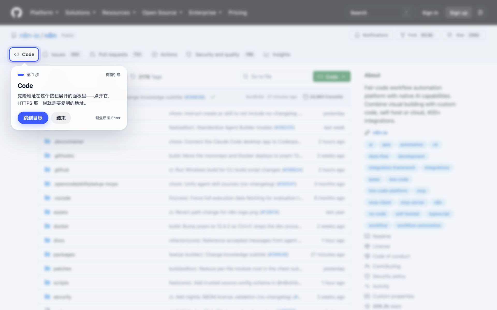
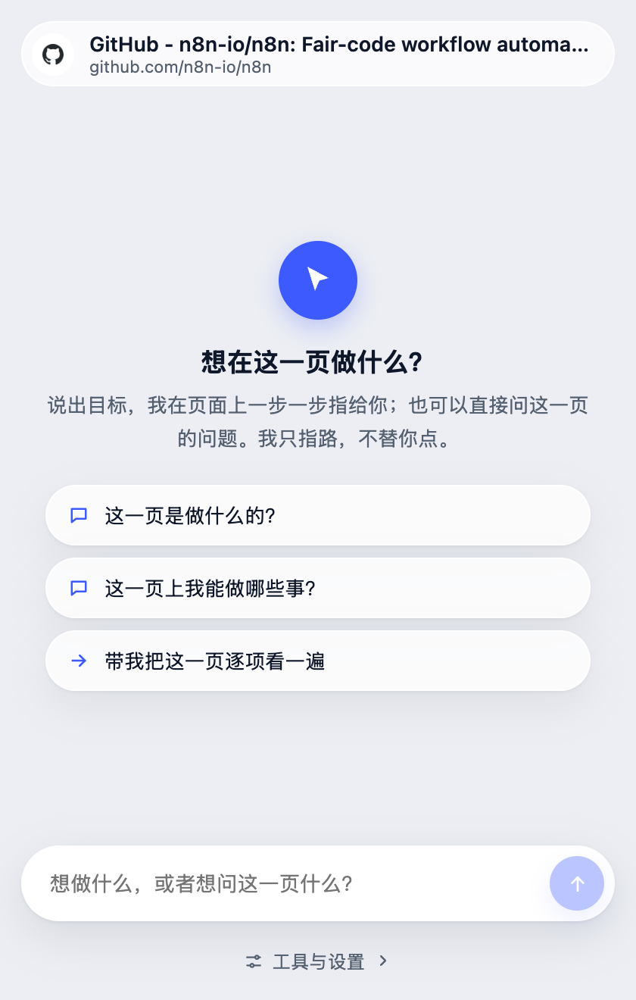
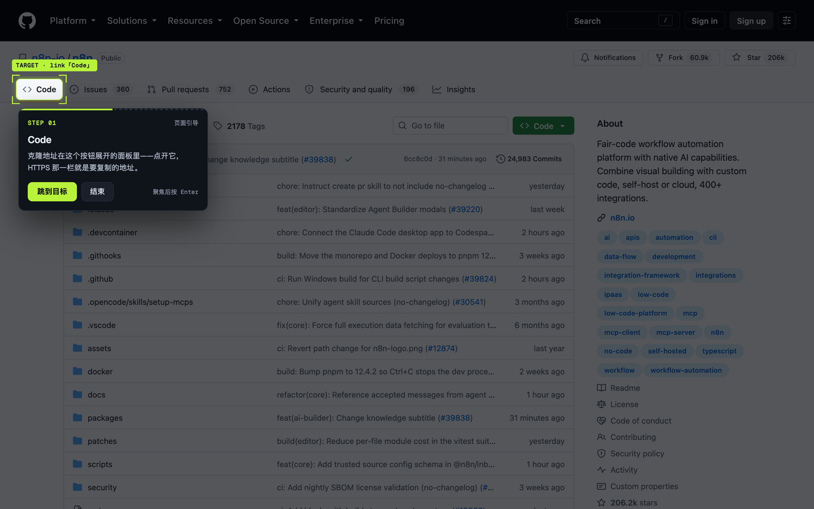
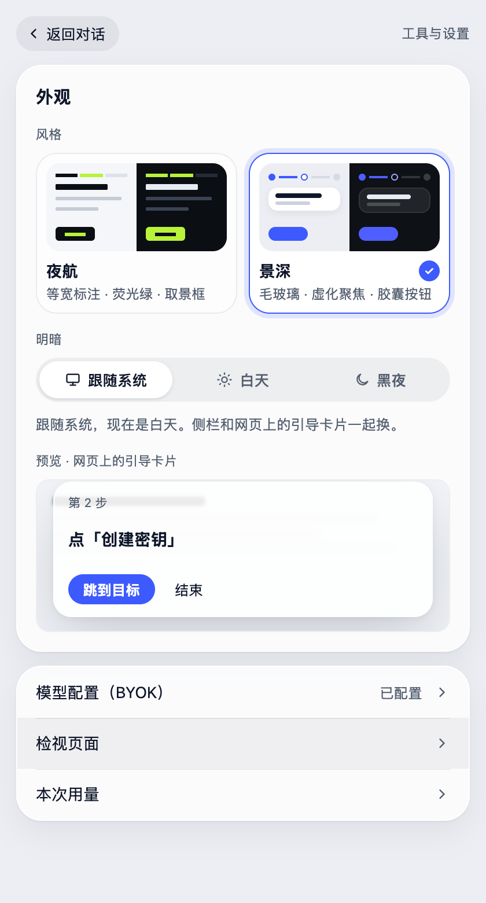
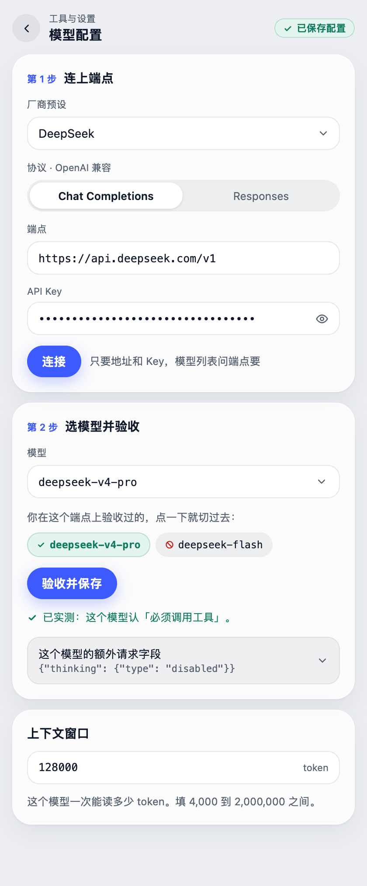

<h1 align="center">Page Guide</h1>

<p align="center">
  <b>在陌生的 Web 控制台上，一步步指出你该点哪里。</b><br/>
  只指路，不开车——手始终是你的。
</p>

<p align="center">
  
  
  
  
  
  
</p>

<p align="center">
  
</p>

<p align="center">
  <sub>真实截图 · 今天的构建 · 真的 github.com。背景的虚化是产品画上去的（「景深」风格把目标之外压下去），<br/>框是产品画的，卡片上那句话是模型写的，<b>按钮还是你自己点</b>。</sub>
</p>

---

你第一次打开一个云控制台、一个后台系统、一个别人家的管理面板——知道要做什么，却不知道该点哪儿。

Page Guide 读这一页上所有能点的东西，问模型「下一步该点哪一个」，然后**在页面上把那一个控件框出来**。

```
                  ┌─────────────────────────────┐
   你说：          │  帮我把这台实例的配额调大    │
                  └─────────────────────────────┘
                                │
   它读这一页 ─────────────────►│  这一页上每一个能点的东西
                                │  去掉重复、保留入口、按预算裁剪
                                ▼
   它问模型 ──────────────────► │  「下一步点哪一个」——只能用函数回答
                                ▼
   它在页面上画一个框 ────────► │  ⌈ 实例详情 ⌋  ← 你自己点
                                ▼
   你点了 ────────────────────► │  页面变了 → 重新读 → 再问下一步
```

---

## 三条不会动摇的边界

| | |
|---|---|
| **只读，不代劳** | 全仓没有一处点击、提交、派发事件、合成键盘、改选区的代码。不是「我们选择不这么做」——是架构守卫把门焊死了：RPC 动词按词判定，出现执行动词即红。唯一的例外是「跳到目标」：它把**焦点**移到那个控件上，回车仍然由你来按。 |
| **你的 Key 只有一个去处** | 只存 `storage.local`（绝不用会同步到云端的 `sync`），只发往你自己填的那个端点。内容脚本**完全够不到扩展存储**，所以页面上的任何漏洞都摸不到它。 |
| **凭据永不被框出** | 密码、验证码、支付字段会出现在给模型的表里（诊断需要），但渲染层拒绝为它们画任何东西。 |

---

## 看得见的那一半

<table>
<tr>
<td width="44%" valign="top">
  
</td>
<td valign="top">

**侧栏是一段对话，不是一块控制面板。**

- 顶上钉着**你此刻在哪一页**——站点图标、标题、域名。引导永远是「针对这一页」的，换了页它就知道。
- 每一步是一张卡。做过的那一步打勾并写上「你做了这一步」——这个判断来自**页面真的变了**，不是模型自称做完了。
- 「指路」和「回答」是两种答法。问「这个仓库是做什么的」不会被硬塞一个框，它照着这一页的内容答你。
- 底下一条输入框，随时插话；再底下是工具与设置。

</td>
</tr>
</table>

---

## 一页两种气质

<p align="center">
  
</p>

<table>
<tr>
<td width="40%" valign="top">
  
</td>
<td valign="top">

**风格**和**明暗**是两个独立的选择：

- **景深** —— 毛玻璃 · 虚化聚焦 · 胶囊按钮（文章开头那张）
- **夜航** —— 等宽标注 · 荧光绿 · 取景框（上面这张）

明暗可以**跟随系统**，也可以钉死在白天或黑夜。侧栏和网页上的卡片**一起换**——它们本来就共用同一套 token。

设置里那块「预览」不是图片，是拿**浮层真正那套 token** 现画的——所以你在这里看到的，就是网页上将会看到的。

</td>
</tr>
</table>

---

## 它怎么工作

### 三个进程，各管各的

```
┌──────────────── 侧栏 Panel（活得久，你看得见的那一半）─────────────────┐
│  对话 · 模型配置 · 成本                                                │
│  guide/runner.ts ──callModel──► transport ──► 你的模型端点（SSE 流式） │
└───────▲────────────────────────────────────────────┬──────────────────┘
        │ effect 结果                                 │ RPC
┌───────┴────────────────────────────────────────────▼──────────────────┐
│               宿主 Host / Service Worker（30 秒空闲就被回收）          │
│  Thread：storage.session 的 guide:{tabId}                             │
│  ┌──────────────────────────────────────────────────────────────┐    │
│  │  machine.ts  step(state, input) → { state, effects }          │    │
│  │  纯归约器：不 await、不碰网络、不碰 chrome.*——所以它能重放     │    │
│  └──────────────────────────────────────────────────────────────┘    │
│  Effects：present │ callModel │ ask │ explain │ observe │ done ……      │
└───────┬────────────────────────────────────────────▲──────────────────┘
        │ HIGHLIGHT                                   │ Reading（8 种读数）
┌───────▼────────────────────────────────────────────┴──────────────────┐
│          内容脚本 Content（在页面里，一次导航就没了）                   │
│  抽取器（元素表） · 浮层（框 + 卡片，closed shadow root + Top Layer）  │
└───────────────────────────────────────────────────────────────────────┘
```

**为什么模型调用在侧栏而不在宿主**：Service Worker 空闲 30 秒就会被回收，而一次模型调用经常更久。所以「谁来决定」和「谁去执行」被拆开——宿主拥有全部判断（一个纯函数），侧栏只负责把它交出去的活干完再送回来。

**为什么归约器必须是纯的**：Worker 被回收之后，线程靠 `storage.session` 里的状态重放回来。只要它不看时钟、不碰网络、不碰平台，同样的 `{state, input}` 就永远得到同样的答案——这也是它能在 node 里毫秒级跑完上千条测试的原因。

### 一次问答的完整链路

1. **读页面** → 抽取器产出 `元素表`：每个可交互控件一行，带角色、名字、所在区块。
2. **发给模型** → 七个意图（四种答法 + 三种工具），模型**只能通过调用函数来回答**。
3. **判定** → 宿主的归约器重新核验：ref 在不在表里、有没有指向敏感字段、这一步是不是刚被拒绝过的那一个。
4. **上屏** → 浮层把那一个控件框出来，卡片写明这一步是什么、为什么。
5. **等你动手** → 你点了、页面变了、目标消失了……八种读数中的任意一种都会把模型叫醒，带着「这一步之后发生了什么」再问下一步。

---

## 元素表：这个产品最核心的一张表

给模型看的不是 HTML，是一张**去过重、留住入口、按预算裁过**的清单。

- **只删重复，永不按相关性裁剪。** 「这个控件和目标有没有关系」需要专门训练过的模型才答得对；词法打分在我们的语料上只有 **60%** 的 top-1，会留噪音、更会丢正解。所以被删的只有 `Restatement`——一层自身不可交互、只裹着唯一一个可交互后代的空壳，删它无损。
- **超预算时入口优先留下。** 导航、页头页脚、标签栏、菜单、工具条、搜索区——它们存在的意义就是把你带去别处。
- **切掉了多少，如实写在表尾。** 「这一页还有 214 个元素没有列出」——「表里没有」和「页面上没有」是两件事。
- **嵌入框架也读得进来。** 账单组件、日志面板、客服窗口常常是 iframe；它们的控件带着 `f3e12` 这样的 ref 进同一张表，进不去的则如实写成一行「我看不到」。

**`Descriptor` 而不是选择器**：一个控件的身份由「作者能从页面上读出来并写下来的东西」组成——角色、名字、所在区块、必要时的序号。合取过滤，不打分、不排序、不打破平局；命中多个就如实说命中多个。快照失效之后，它是唯一还能把同一个元素找回来的东西。

---

## 模型接口：一个端点用到底

<table>
<tr>
<td valign="top">

自带 Key（BYOK），配**一个**端点用到底，在那个端点上挑你觉得合适的模型。

```
①「连接」  地址 + Key  ──► GET /models
                        ──► 这个端点真有的模型列表

②「验收」  选中一个    ──► 一次最小真调用
                        ──► 它到底能不能驱动本产品
```

为什么必须两步：第二步是**对着某一个具体模型**发出去的真调用——模型没选，它就无从发起。而「在 `/models` 里」离「能用」还很远：同一份目录里有 503 的、500 的、要多一个字段才肯答的。

- **协议可插拔**：`openai-chat` 与 `openai-responses` 各一份 `prepare`/`parse` 纯函数，中立类型在中间。全仓**只有一个地方能发出网络请求**（`transport.ts`），所以你的 Key 只有一个去处。
- **按模型记住两件事**：这个模型要的额外请求字段（有些模型的思考模式会拒收「必须调用工具」），以及它验收的结果。修好过的模型，下次挑回来还是好的。
- **撞墙时给出口**：验收失败不是甩一句英文报错，而是人话 + 一个按钮，按下去自己试出这个端点认哪种写法。

</td>
<td width="40%" valign="top">
  
</td>
</tr>
</table>

---

## 验证体系（Harness）

这个仓库把「怎么证明它没坏」当成主线的一部分，而不是附属品。

### 三层，各自回答不同的问题

| 层 | 规模 | 回答什么 | 命令 |
|---|---|---|---|
| **单元测试** | **1144 条 / 64 个文件** | 归约器、契约、协议适配器、抽取器的每一条规则 | `npm test` |
| **架构守卫** | **56 条**（在单测里） | 那些「只能靠纪律维持」的约束，改坏了立刻红 | 同上 |
| **端到端** | **272 条断言** | 真 Chrome、真页面、真浮层，模型端点打桩 | `npm run e2e` |
| **抽取器评测** | 22 个夹具 / 30 个标注目标 | 「指出来的那个框，是不是就是标注的那个元素」 | `npm run eval` |

### 架构守卫：用编译器读源码，而不是用正则

守卫不是 lint 规则，是**对着 TypeScript AST 提问**。举几条真在跑的：

```
只有 transport 与 fetchDoc 执行器可以发起网络请求
归约器在运行时能加载到的每一个文件都不得出现 await / fetch( / chrome.
每个协议的请求体字段都落在它自己那张白名单内（spread 里面也要展开来看）
预设声明的每一个厂商字段都必须有一手文档与实测记录（`PRESET_FIELDS`）
内容脚本不得触碰扩展存储（密钥隔离）
RPC 动词里没有执行动词：按动词名里的词判，不按一份名单
注进页面框架的那段探针只许看尺寸
```

**每条守卫都自检两次**：它的文件范围必须至少命中一个文件（范围匹配不到东西的守卫恒真，那是守卫悄悄死掉的方式），它的探测器必须在一段**合成的违规代码**上真的报警。

### 端到端：断言的是状态跃迁，不是某一刻的截图

e2e 跑的是真的 Chrome 扩展：真的 Service Worker、真的内容脚本、真的 closed shadow root、真的 Top Layer。模型端点用本地桩，所以零网络、可重放。

它抓过的缺陷是这一类：「点击后约 50ms 提示框改口说『找不到目标』，而真正的下一步要等一次模型往返」——**失效屏只存在几十毫秒**，轮询快照永远看不到它，所以断言写在 `MutationObserver` 记下的整条跃迁序列上。

### 抽取器评测：五档判定，L-4 是硬零门

```
recall@budget  100%  ≥ 95%      top1_ceiling  100%  ≥ 92%
L-1 唯一且正确  100%  ≥ 90%      L-2 多候选      0%   ≤  8%
L-3 没找到       0%  ≤  2%      L-4 唯一但指错   0%   =  0%   ← 硬零门
```

判定是**对着真实坐标做几何比较**，不是问抽取器「你觉得你找对了吗」。

> 这把尺子曾经被一个少写的字段压成 L-1 0% 十几天——渲染命令缺了 `view`，每个目标都被判成「不是这一页的」。修好之后 30 个目标全部 L-1。教训写在 `evals/extract/capture.mjs` 的注释里：**一个会因为自身之外的原因而失败的指标，必须大声说出来**，因为 0% 读起来和真的回归一模一样。

### 几条贯穿始终的纪律

- **语料一个字不改。** 固化的真实请求是证据；为了让断言变绿而改它，等于把证据改成结论。
- **发给模型的字节被冻结。** 提示词、schema、元素表的拼装顺序，任何一个字变了，快照测试就红。
- **不确定的事不写进记录。** 探测失败时开关留在「未知」，端点的原话原样转给用户——转述之后，那个能让人动手的关键词就没了。

---

## 上手

```bash
npm install
npm run dev          # 开发模式，热重载
npm run build        # 产出到 dist/，chrome://extensions 里「加载已解压」

npm run verify       # 类型检查 + 单测 + e2e，提交前跑这一条
npm run eval         # 抽取器评测（需要 Chromium，零网络）
```

需要 Chrome 120+（浮层用了 Top Layer，那是平台契约，不是渐进增强）。

首次使用：侧栏 →「模型配置（BYOK）」→ 填端点和 Key →「连接」→ 选模型 →「验收并保存」。

> README 里这几张图不是画的，是 `tests/e2e/shots.mjs` 和 `tests/e2e/shot-panel.mjs` 用**今天的构建**在真 Chrome 上拍的，零模型调用。改完界面重跑一遍就是新的。

---

## 仓库导览

```
src/
  core/          页面侧：抽取器、浮层、定位、可操作性、敏感字段
  agent/         判断侧（不碰平台）
    thread/        纯归约器、状态、effect 协议、单写者
    agents/guide/  七个意图各一个模块：schema、识别、校验、后果
    provider/      transport（唯一联网点）、协议适配器、中立类型
    context/       发给模型的那份上下文怎么拼
  entrypoints/   content.ts（页面里）· background.ts（宿主）· sidepanel/（界面）
  shared/        两侧共用的协议与类型

tests/           单测 · e2e · 夹具页 · 效果图脚本
evals/           抽取器评测；另有离线与真机评测的脚手架（目前不作为验收门槛）
```

## 想读懂它，从哪里开始

| 文件 | 它回答什么 |
|---|---|
| **`CONTEXT.md`** | **先读这个。** 这个产品的词汇表：`Ref`、`Descriptor`、`Thread`、`Reading`、`Arrival` 各是什么，以及每个决定后面的「> 为什么」 |
| `.scratch/README.md` | 十二条规格流的索引：做过什么、**以后别重做什么**、不可再生的实测数据在哪 |
| `docs/design.md` | Agent 层的设计文档（§13 的阶段表已作废，其余条款仍然有效） |
| `tests/unit/architecture.spec.ts` | 那些「只能靠纪律维持」的约束，逐条写成了可执行的断言 |

代码里的注释密度是刻意的：**结论写在代码里，理由写在注释里**——尤其是那些「我们试过 X，结果是 Y，所以选了 Z」的地方，因为 Z 看得出来，X 和 Y 看不出来。
